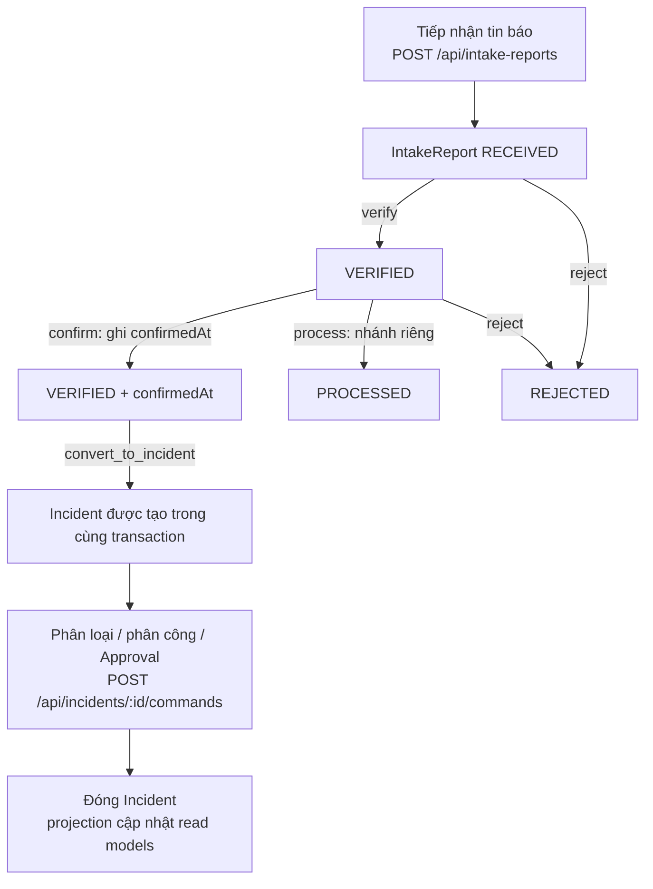
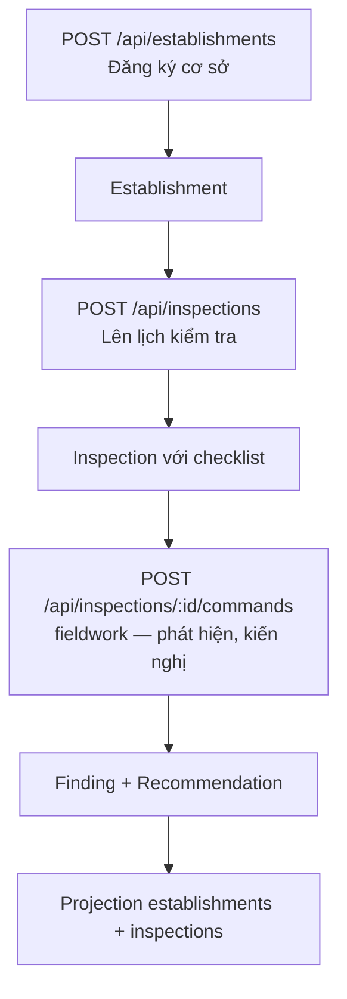
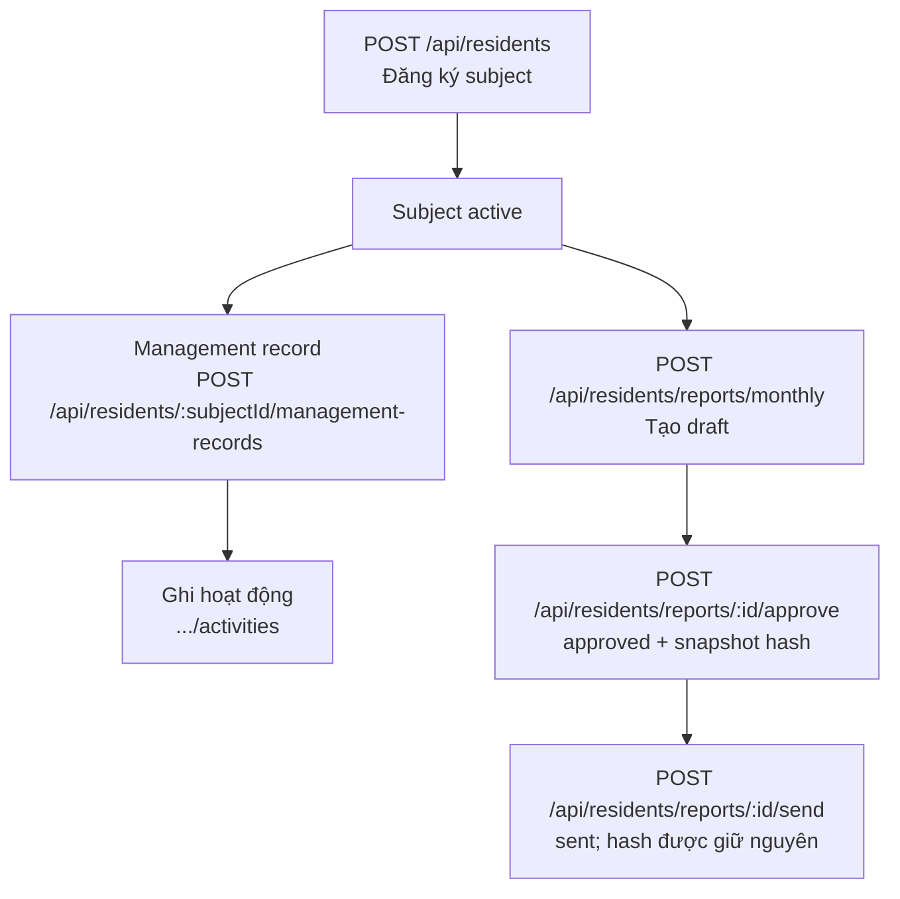
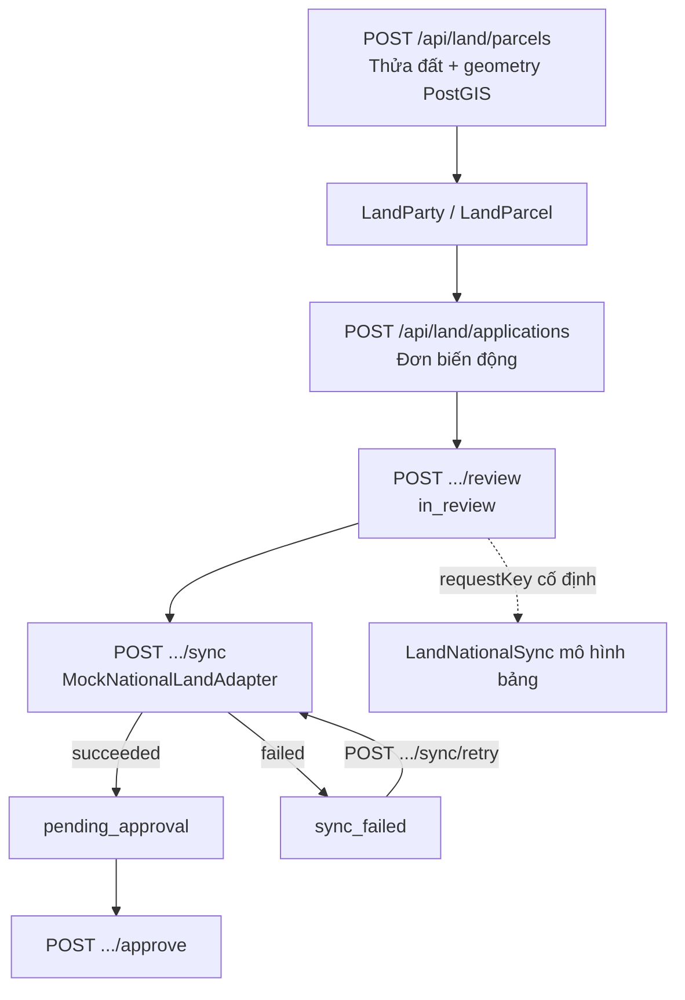
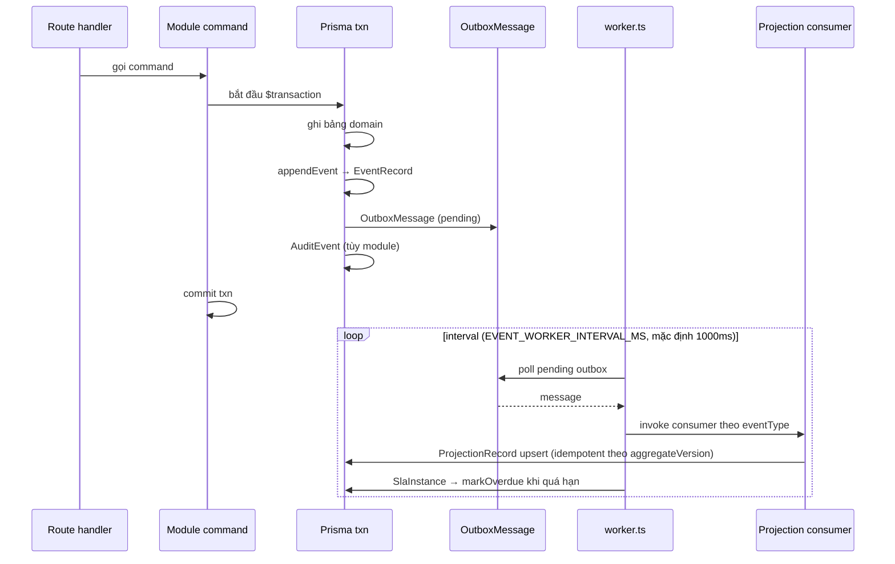

# Luồng nghiệp vụ chính (AS-IS)

Snapshot: baseline `567380b3c6fea42d359a99d41a8fe4e60134ffa9`, 2026-10-28. Code-derived; không phải yêu cầu hay phê duyệt.

Mỗi luồng dưới đây được suy ra từ route handlers và command services thực tế. Các **luồng ghi (mutating command flows)** đi qua một cơ chế chung: **route → command service → (Prisma transaction + appendEvent + Outbox)**, sau đó worker chuyển sự kiện thành projection/read model. Lưu ý:
- Điều này áp dụng cho **các luồng lệnh ghi có chủ đích sử dụng eventing**; các route chỉ đọc (GET) không ghi.
- **Không khẳng định mọi thao tác ghi dữ liệu đều tự động phát sinh sự kiện** — event được emit tại nơi command service gọi `appendEvent`, không phải auto trigger từ DB.

## 1. Tin báo → Incident (nghiệp vụ trung tâm)



Giải thích luồng chuyển đổi — **conversion không phải là `POST /api/incidents` dạng chung**: chuyển tin báo thành Incident phải qua lệnh `convert_to_incident` tại `POST /api/intake-reports/[reportId]/commands`, với điều kiện IntakeReport đã `VERIFIED` và có `confirmedAt`. `confirm` phải chạy sau `verify`; `process` là một nhánh riêng (không phải bước trung gian của convert). `POST /api/incidents` dùng khi đăng ký Incident mới trực tiếp.

Bằng chứng chính:
- Route intake: `src/app/api/intake-reports/route.ts` (GET, POST); commands route `src/app/api/intake-reports/[reportId]/commands/route.ts:36-83` (dispatch các command, gồm `convert_to_incident`).
- Convert service: `src/modules/incidents/commands.ts:1223-1391` (`convertIntakeToIncident`: VERIFIED + confirmedAt, appendEvent `IntakeReportConvertedToIncident`, cùng transaction).
- Route: `src/app/api/incidents/route.ts` (GET, POST), `src/app/api/incidents/[incidentId]/commands/route.ts` (POST).
- Projection sự kiện intake (lifecycle RECEIVED→VERIFIED→PROCESSED→REJECTED→CLOSED): `src/modules/incidents/projection.ts:149-196`.
- SLA được tạo qua `src/modules/platform/sla/index.ts:38-88` trong transaction của lệnh nghiệp vụ (cho các flow có SLA).

## 2. Kiểm tra (Establishment → Inspection)



Bằng chứng: `src/app/api/inspections/route.ts`, `src/app/api/inspections/[id]/commands/route.ts`, `src/app/api/inspections/stats/route.ts`, `src/modules/inspections/projection.ts:178-224` (register Establishment và Inspection consumer).

## 3. Phương tiện (registry → observation → watch → verification)

```mermaid
flowchart TD
    A[POST /api/vehicles/observations<br/>nhập tay khi đi tuần] --> B[recordVehicleObservation]
    B --> C[VehicleObservation ghi qua API]
    C --> D[Parking watch + verification]
    E[POST /api/vehicles/registry<br/>Đăng ký xe cần chú ý] --> F[SuspiciousVehicleEntry]
    C -->|matchedRegistryId (soft)| F
    F --> G[Xem statistics<br/>GET /api/vehicles/statistics]
```

Về nguồn quan sát: route `POST /api/vehicles/observations` **nhận ghi nhận quan sát nhập tay** qua API (`src/app/api/vehicles/observations/route.ts:22-38` → `recordVehicleObservation`). Trong source có một adapter cục bộ **fixture camera** (`src/modules/vehicles/mock-camera-adapter.ts:8-53`) nhưng nó **không phải nguồn dữ liệu live cho endpoint POST này**, và cũng không có camera thật nào được tích hợp. Sơ đồ cố ý không vẽ fixture như pipeline cố định.

Bằng chứng: `src/app/api/vehicles/registry/route.ts` (GET, PATCH, POST), `src/app/api/vehicles/observations/route.ts` (GET, POST; POST ghi qua `recordVehicleObservation` — :22-38), `src/modules/vehicles/mock-camera-adapter.ts:8-53` (fixture nội bộ, không phải integration), `src/modules/vehicles/projection.ts:164-227`.

## 4. Cư dân đặc biệt (Subject → hồ sơ → báo cáo)



Thứ tự báo cáo tháng thực tế là **approve trước, send sau** (`draft → approved → sent`): `approveReport` tại `src/modules/residents/commands.ts:877-946` tạo `snapshotPayload`/`snapshotHash` và event `PeriodicReportApproved`; `sendReport` tại `:948-1005` yêu cầu trạng thái `approved`, xác nhận hash không đổi rồi emit `PeriodicReportSent`.

Bằng chứng: `src/app/api/residents/**` (đã liệt kê method trong [interfaces-apis.md](interfaces-apis.md)); projection `src/modules/residents/projection.ts:12-62` (SubjectRegistered → SubjectRiskRaised → SubjectTransferred → PeriodicReportGenerated/Approved).

## 5. Đất đai (Parcel → Application Review → Sync → Approve)



Bằng chứng:
- `src/app/api/land/applications/[applicationId]/{review,sync,sync/retry,approve,reject}/route.ts` (tất cả POST).
- Sync service: `src/modules/land/sync-service.ts:86-280` — cùng transaction, event `LandChangeApplicationSyncSucceeded/Failed`, audit, không đổi LandRight/LandParcel/LandEncumbrance trực tiếp (comment dòng 83-85).
- Mock adapter: `src/modules/land/national-land-adapter.ts:71-90` — mocked, **không mạng**, `options.outcome` lấy từ `LAND_MOCK_SYNC_OUTCOME` env sync-service.ts:65-71.
- Tra cứu công khai: `src/app/api/public/land/lookup/route.ts`, `public-lookup-service.ts:47` (`simulated: true`).

## 6. Eventing và SLA nền tảng



Bằng chứng: `src/worker.ts:1-28` (đăng ký 5 projection rồi tick), `platform/sla/index.ts:90-128` (markOverdue), eventing projections `src/modules/incidents/projection.ts:117-148` (register consumer + idempotent rule từ `eventing/read-model.ts:26-59`).

## Ranh giới và privacy cần nhớ

- Tất cả các luồng ghi chạy qua server; mobile chỉ ghi cho một nhóm có giới hạn (xem [module-status.md](module-status.md) phần mobile-readonly); **mobile không ghi đầy đủ như web**.
- Tín hiệu mô phỏng: projection thửa đất trên bản đồ (`GET /api/map/land-parcels`) và public land lookup trả `simulated: true`; điều này không đồng nghĩa provider style/tile nền của TileServer GL là dữ liệu mô phỏng (`src/modules/land/parcel-map-discovery.ts:50-55, 269-277`, `src/modules/land/public-lookup-service.ts:45-48, 65-78`, `src/modules/platform/map/index.ts:9,78-98`).
- **Không có sự kiện thật nào từ hệ thống ngoài**: camera và CSDL quốc gia đều là mock. Không nên kết luận "đã kết nối IOC quốc gia" từ snapshot này.
- Demo chỉ dùng seed synthetic (`scripts/demo/seed.ts`); demo target guard chặn DB khác `civicos` local (`src/modules/demo/target-guard.ts:38-112`).
- Không trích giá trị dữ liệu ví dụ cá nhân hoặc biển số thực tế trong tài liệu; chỉ liệt kê mức mô hình dữ liệu theo `prisma/schema.prisma`.
