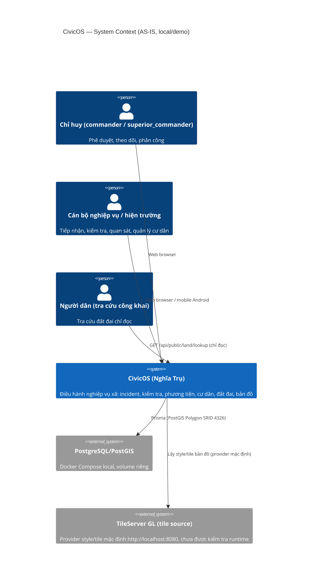
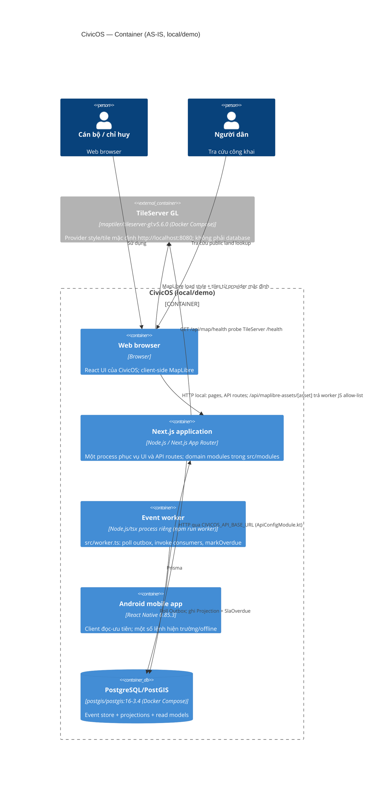
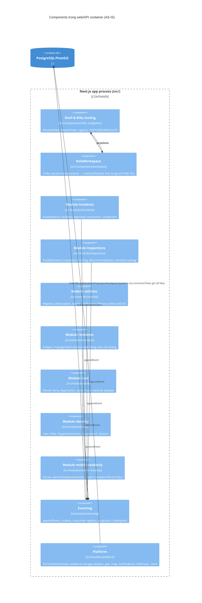

# C4 — Level 1/2/3 (AS-IS)

Snapshot: baseline `567380b3c6fea42d359a99d41a8fe4e60134ffa9`, 2026-10-28. Code-derived; không phải phê duyệt hay chuẩn production. **Chưa có deployment production** — topology dưới đây là local/demo (xem [deployment.md](deployment.md)).

## Level 1 — System Context

Web/API của CivicOS phục vụ cán bộ Công an xã (chỉ huy, tổ trưởng, nhân viên nghiệp vụ, hiện trường) và một luồng tra cứu công khai đất đai. Mobile là khách hàng **đọc-ưu tiên** và không kết nối trực tiếp database.

Sơ đồ chỉ thể hiện dependency hệ thống; camera và CSDL quốc gia **không** phải dependency ngoài sống mà là mock/fixture cục bộ trong source. TileServer GL là biên dịch vụ được cấu hình (chưa chạy/kiểm chứng trong snapshot này).

Bằng chứng: `src/components/navigation/feature-registry.ts:44-91` (vai trò `commander`/`superior_commander`), `src/app/api/public/land/lookup/route.ts`, `src/modules/land/public-lookup-service.ts:47` (`simulated: true`), `src/modules/land/national-land-adapter.ts:38-90`, `src/modules/vehicles/mock-camera-adapter.ts:8-53`, `src/components/map/MapWorkspace.tsx:212` (client yêu cầu `body.simulated === true`), `docker-compose.yml`.

## Level 2 — Containers

Bằng chứng: `docker-compose.yml` (chỉ postgres + tileserver, không có container web/worker); `package.json` (scripts `dev`, `worker`), `src/worker.ts:1-28`; `mobile/android/app/src/main/java/com/civicosmobile/ApiConfigModule.kt:4-16`; `mobile/src/App.tsx:1-18`; provider bản đồ `src/modules/platform/map/index.ts:9,78-98` (style mặc định từ TileServer, `official:false`); asset route `src/app/api/maplibre-assets/[asset]/route.ts:1-47` (allow-list 2 file JS trong `node_modules/maplibre-gl/dist`); health probe `src/app/api/map/health/route.ts:1-30`.

Dịch vụ local là HTTP dev server (không có HTTPS/reverse proxy trong source); mobile gọi `api` theo cùng cách HTTP.

## Level 3 — Components (trong `src/`)

CivicOS là **monolith modular TypeScript**: một server Next chứa các module nghiệp vụ dưới `src/modules/`, chia sẻ chung module nền tảng (clock/evidence/geo/map/notifications/sla/field-sync).

Điểm quan trọng:
- **Worker là process riêng** (`npm run worker`), không nằm trong ảnh component `src/` — ở trên chỉ mô tả các seam trong Next process.
- **Mobile offline command KHÔNG đi qua `mobile-readonly` để appendEvent**: mobile biến lệnh offline vào qua `POST /api/sync` (`src/app/api/sync/route.ts`, `OfflineCommand`), sau đó các business command service giới hạn + platform xử lý; `mobile-readonly` chỉ phục vụ đọc.

Composition chính:
- `src/worker.ts:11-15` đăng ký projections: event-history, incident, inspection, notification, vehicle (+ SLA consumer qua platform).
- Điều hướng: `feature-registry.ts:46-91` khai báo 7 module (`incidents, inspections, vehicles, identity, map, residents, land`); `workspace-registry.ts:29-51` build projection; `ModuleShell.tsx:112-178` render.
- **Seam dữ liệu sự kiện:** route `POST` gọi command service → `appendEvent` (same transaction) → outbox → worker tick → registered consumers cập nhật `ProjectionRecord` read model (e.g. `src/modules/incidents/projection.ts:117-146`, `src/modules/vehicles/projection.ts:164-208`).
- **Seam platform:** SLA create/markOverdue tại `src/modules/platform/sla/index.ts:38-128`; evidence storage qua `src/modules/platform/evidence/storage-adapter.ts`.

Ranh giới quan trọng:
- **Điều hướng không phải authorization:** `feature-registry.ts` lọc theo role/task/organization chỉ để quy định tính hiển thị; việc cho phép/cấm thao tác được server enforce qua access check từng route/module (như `requireLandReviewAccess` tại `src/modules/land/sync-service.ts:105-113, 305-313`). Xem `src/components/navigation/ModuleTabs.tsx:9-11` ("it never grants entry permission").
- **Boundaries tích hợp ngoài:** camera và CSDL quốc gia là **mock/fixture cục bộ, không mạng**; TileServer GL là biên dịch vụ thật được **cấu hình** (chưa runtime-check) — chi tiết tại [module-status.md](module-status.md).
