# Thiết kế dữ liệu (AS-IS)

Snapshot: baseline `567380b3c6fea42d359a99d41a8fe4e60134ffa9`, 2026-10-28. Nguồn duy nhất: `prisma/schema.prisma` (695 dòng). Đây là mô hình dữ liệu mà code khai báo, **không** xác nhận dữ liệu runtime/production và **không** là tài liệu dữ liệu pháp lý.

## Tổng quan nhóm model

`datasource db` dùng `prisma` provider với PostGIS ở schema PostgreSQL (schema.prisma:5-9). Các model được nhóm theo module nghiệp vụ:

- **Identity/Phân quyền:** `User`, `Role`, `UserRole`, `OrganizationUnit`, `Assignment`, `Session` (dòng 10-81).
- **Eventing / Platform nền tảng:** `EventRecord`, `OutboxMessage`, `ProjectionCheckpoint`, `ProjectionRecord`, `AuditEvent`, `Evidence`, `SlaInstance`, `Notification`, `OfflineCommand` (dòng 82-237).
- **Incidents / Tin báo:** `IntakeReport`, `IntakeCommand`, `Incident`, `Approval` (dòng 238-319).
- **Inspections:** `Establishment`, `ChecklistTemplate`, `Inspection`, `InspectionFinding`, `EnforcementRecommendation` (dòng 320-402).
- **Vehicles:** `SuspiciousVehicleEntry`, `VehicleObservation`, `VehicleParkingWatch`, `VehicleVerification` (dòng 403-468).
- **Residents (cư dân đặc biệt):** `Subject`, `SubjectManagementRecord`, `SubjectManagementActivity`, `ResidentMonthlyReport` (dòng 469-544).
- **Land:** `LandParty`, `LandParcel` (PostGIS Polygon 4326 — dòng 572), `LandChangeApplication`, `LandRight`, `LandEncumbrance`, bảng link `LandApplicationParty`/`LandApplicationParcel`, `LandNationalSync` (dòng 545-694).

## Sơ đồ quan hệ (đối chiếu FK thực tế trong schema)

Quy ước: nét liền `--` = FK được `@relation` khai báo trong Prisma; nét đứt `..` = tham chiếu scalar/logical **không có FK** (soft reference).

```mermaid
erDiagram
    %% Quan hệ FK được @relation khai báo
    USER ||--o{ USERROLE : "userId (Cascade)"
    ROLE ||--o{ USERROLE : "roleId (Cascade)"
    USER ||--o{ SESSION : "userId (Cascade)"
    USER ||--o{ ASSIGNMENT : "assigneeUserId"
    SUBJECT ||--o{ SUBJECTMANAGEMENTRECORD : "subjectId (Cascade)"
    SUBJECTMANAGEMENTRECORD ||--o{ SUBJECTMANAGEMENTACTIVITY : "recordId (Cascade)"
    VEHICLEOBSERVATION ||--o| VEHICLEPARKINGWATCH : "observationId @unique (Cascade)"
    LANDPARCEL ||--o{ LANDRIGHT : "rights"
    LANDPARCEL ||--o{ LANDENCUMBRANCE : "encumbrances"
    LANDPARTY o|--o{ LANDENCUMBRANCE : "securedPartyId optional FK"
    LANDPARTY ||--o{ LANDAPPLICATIONPARTY : "link"
    LANDCHANGEAPPLICATION ||--o{ LANDAPPLICATIONPARTY : "link"
    LANDPARCEL ||--o{ LANDAPPLICATIONPARCEL : "link"
    LANDCHANGEAPPLICATION ||--o{ LANDAPPLICATIONPARCEL : "link"
    LANDCHANGEAPPLICATION ||--o{ LANDNATIONALSYNC : "nationalSyncs"

    %% Quan hệ một-một optional
    EVENTRECORD ||--o| OUTBOXMESSAGE : "eventId @unique FK; outbox optional"
    %% Tham chiếu logic optional, không khai báo FK
    INTAKEREPORT o|..o| INCIDENT : "incidentId/intakeReportId scalar unique"

    %% Tham chiếu scalar/logical (KHÔNG FK)
    USER ||..o{ ASSIGNMENT : "grantedById (scalar)"
    ORGANIZATIONUNIT o|..o{ USER : "organizationUnitId (optional scalar)"
    ORGANIZATIONUNIT o|..o{ ORGANIZATIONUNIT : "parentId (optional scalar)"
    ORGANIZATIONUNIT o|..o{ ASSIGNMENT : "organizationId (optional scalar)"
    INTAKEREPORT ||..o{ INTAKECOMMAND : "reportId (scalar)"
    ESTABLISHMENT ||..o{ INSPECTION : "establishmentId (scalar)"
    CHECKLISTTEMPLATE ||..o{ INSPECTION : "templateId (scalar)"
    INSPECTION ||..o{ INSPECTIONFINDING : "inspectionId (scalar)"
    INSPECTION ||..o{ ENFORCEMENTRECOMMENDATION : "inspectionId (scalar)"
    VEHICLEOBSERVATION ||..o{ VEHICLEVERIFICATION : "observationId (scalar)"
    SUSPICIOUSVEHICLEENTRY o|..o{ VEHICLEOBSERVATION : "matchedRegistryId (optional scalar)"
    %% Platform model dùng tham chiếu generic resourceType/resourceId
    AUDITEVENT
    EVIDENCE
    NOTIFICATION
    OFFLINECOMMAND
    SLAINSTANCE {
        string overdueEventId
    }
    RESIDENTMONTHLYREPORT {
        json sourceRecordIds
    }
```

Xuất xứ: `prisma/schema.prisma` (dòng trong bảng trên). Quy tắc event-record/outbox là một **pattern được các luồng lệnh ghi (command flows) dùng** (`src/modules/eventing/*`, ví dụ `read-model.ts:26-59`); không phải cam kết mọi thay đổi dữ liệu trong DB đều tự động phát sinh event.

## Điểm quan trọng của mô hình

1. **Event/outbox/projection pattern (không phải event sourcing toàn phần):** các luồng lệnh ghi nghiệp vụ phù hợp ghi `EventRecord` + `OutboxMessage` trong cùng transaction; `ProjectionRecord` giữ read model được worker cập nhật theo `aggregateVersion` (`src/modules/eventing/read-model.ts:26-59`). Đây là pattern được command flow áp dụng — không phải cam kết DB tự sinh event cho mọi thay đổi.
2. **LandParcel.geometry** là `Unsupported("geometry(Polygon,4326)")` — Prisma chỉ chuyển tiếp (schema.prisma:572). Các thao tác geometry phải viết SQL PostGIS riêng (được `src/modules/land/parcel-map-projection.ts` và `GET /api/map/land-parcels` vận dụng).
3. **SlaInstance** lưu tham chiếu sự kiện quá hạn qua `overdueEventId`, liên kết tới event được tạo bởi `markOverdue` (`src/modules/platform/sla/index.ts:90-128`).
4. **OfflineCommand** đại diện cho lệnh từ mobile chờ đồng bộ qua `POST /api/sync` (schema dòng 216-237 và API tại `src/app/api/sync/route.ts`).
5. **AuditEvent** được tạo thủ công trong lệnh nghiệp vụ (`auditLandEvent` tại `src/modules/land/sync-service.ts:248-269`), không phải auto-trigger từ DB.

## Không có / giới hạn

- ER diagram thể hiện quan hệ theo các FK thấy trong schema, cộng một số tham chiếu mềm có chủ đích (`matchedRegistryId`, `incidentId`); các platform model như `AuditEvent`, `Evidence`, `Notification`, `OfflineCommand` dùng tham chiếu generic `resourceType`/`resourceId` nên không có FK — kiểm tra chi tiết luôn qua schema file.
- Index/unique chi tiết của từng model không được liệt kê hết trong tài liệu; cần đọc schema trực tiếp.
- **Không** xác nhận runtime: schema chỉ khai báo mô hình, chưa chứng minh dữ liệu thực tế; cần chạy migration + kiểm tra DB riêng (không chạy trong snapshot này).
- Schema chỉ nên thay đổi qua `prisma migrate` (README gốc); snapshot này không thiết kế thay đổi schema.
