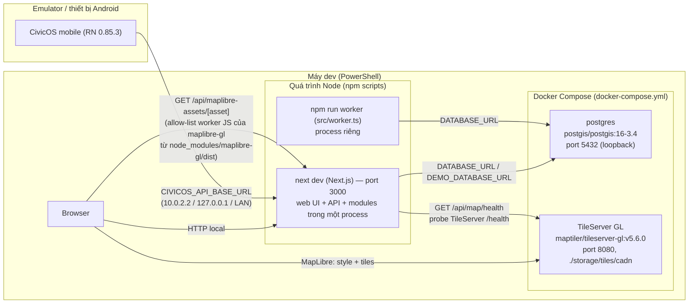

# Kiến trúc triển khai (AS-IS — chỉ local/demo)

Snapshot: baseline `567380b3c6fea42d359a99d41a8fe4e60134ffa9`, 2026-10-28. **Không có deployment production trong source. Mọi mô tả dưới đây chỉ topology local, dựa trên repository và Docker Compose hiện tại.**

## Topology local

Bằng chứng: `docker-compose.yml` (chỉ khai báo `postgres` và `tileserver`, **không** định nghĩa container web hoặc worker); `package.json` (scripts `dev`, `worker`, `demo:bootstrap`); `mobile/android/app/src/main/java/com/civicosmobile/ApiConfigModule.kt:4-16` (tên biến `CIVICOS_API_BASE_URL` cấu hình tại build thời gian). Thứ tự cài đặt theo `README.md` gốc.

## Các thành phần và vai trò

| Thành phần | Nguồn cấu hình | Vai trò | Ghi chú giới hạn |
|------------|----------------|---------|------------------|
| PostgreSQL/PostGIS | `docker-compose.yml`, `prisma/schema.prisma:5-8, 572` | Database chính, PostGIS Polygon 4326 | Volume `civicos-postgres` cố định, không auto backup |
| TileServer GL | `docker-compose.yml`, `src/modules/platform/map/index.ts:9,78-98` | Provider style/tile bản đồ mặc định (`http://localhost:8080`, `official:false`) | Serves từ `./storage/tiles/cadn`; phải nạp tile trước; **dịch vụ thật được cấu hình, nhưng chưa được kiểm chứng đã chạy trong snapshot này** |
| Next.js web/API | `npm run dev` (port 3000) | Server render + REST API + UI trong **một process** | Dev server HTTP; **chưa cấu hình production**, không có reverse proxy/HTTPS trong repo |
| Event worker | `npm run worker` (`src/worker.ts`) | Consumer outbox | Chạy ở **process Node/tsx riêng**; interval mặc định trong code là **1000ms** (`src/worker.ts:17`), README demo đặt mẫu `500ms` |
| Mobile Android | `npm run android`, Metro (`mobile/`) | Client read-ưu tiên | Không có iOS project/script trong repo |
| Demo target guard | `src/modules/demo/target-guard.ts` | Chặn target DB ngoài local demo | `npm run demo:reset` đã retire theo README |

## Biến môi trường và secret

Snapshot này **không** đọc nội dung `.env` (chỉ liệt kê tên biến từ code/README). Các tên biến xuất hiện là: `DATABASE_URL`, `DEMO_DATABASE_URL`, `DEMO_NOW`, `EVENT_WORKER_INTERVAL_MS`, `LAND_MOCK_SYNC_OUTCOME`, `CIVICOS_E2E_DATABASE_URL`, `ORG_GRADLE_PROJECT_CIVICOS_API_BASE_URL`, `RUN_DB_TESTS`, `CIVICOS_API_BASE_URL`. Không thay đổi cấu hình; **không ghi nội dung secret** vào docs.

## Giới hạn deployment runtime chưa được kiểm chứng

Snapshot này **không** chạy build, service, migration hoặc seed. Do đó các điểm sau chỉ "có cấu hình/code", không phải "đã vận hành":
- Thứ tự khởi động an toàn giữa `postgres` → migration → worker/web.
- Nạp tiles vào `storage/tiles/cadn` (yêu cầu người dùng tự cấp dữ liệu; không được dùng DB dump hay dữ liệu thật).
- Hành vi cạnh tranh qua nhiều worker: source outbox có **claim coordination có điều kiện** (claim token + atomic `updateMany`, cập nhật claimedAt/stale claim release — `src/modules/eventing/outbox.ts:61-70, 166-215`), nhưng vận hành nhiều process/scale thực tế **chưa được kiểm chứng runtime** trong snapshot này.
- Demo bootstrap preflight chặn `DEMO_TARGET_*`, nhưng chưa xác minh qua execution trong snapshot này.
- Không có cấu hình CI, HTTPS, load balancer, secrets manager; **hệ thống chưa chuẩn bị production**.

## Không có trong snapshot này

- Không có Docker Compose hay Helm/manifest nào để deploy web/worker lên một môi trường thật — chỉ hai service postgres + tileserver trong `docker-compose.yml` hiện tại.
- Deployment pipeline/CI definition.
- Chứng chỉ TLS, ingress, backup automation.
- **Chỉ đọc, không hành động thiết lập cấu hình/infrastructure** — mọi giả định triển khai nên được Chief/spec xác thực riêng.
