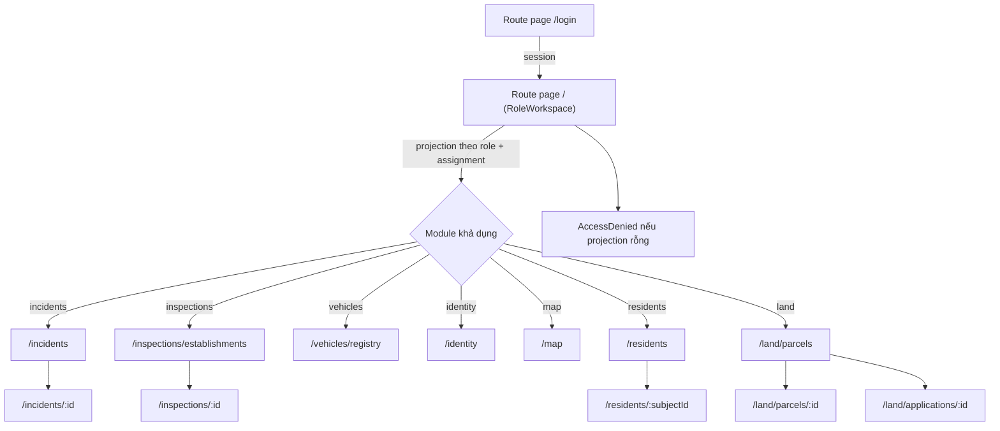
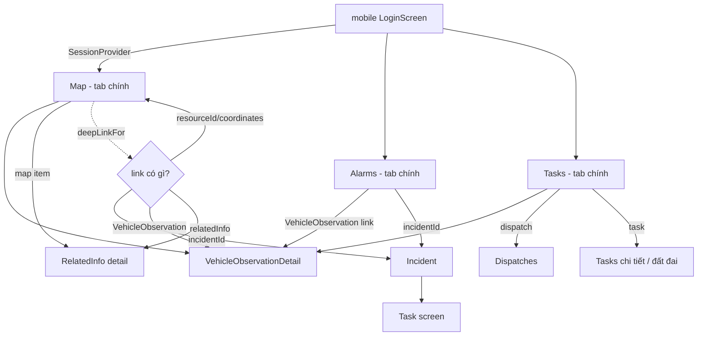

# Luồng màn hình (AS-IS)

Snapshot: baseline `567380b3c6fea42d359a99d41a8fe4e60134ffa9`, 2026-10-28. Code-derived; không phải thiết kế UI đã duyệt.

## Web — Cấu trúc trang

Liệt kê route page thực tế từ `src/app/**/page.tsx` (nhóm chỉ mang tính trình bày):

| Nhóm | Route page |
|------|-----------|
| Shell / identity | `/login`, `/`, `/assignments`, `/users`, `/identity` |
| Incidents & intake | `/incidents`, `/incidents/[incidentId]`, `/intake`, `/intake/[reportId]` |
| Inspections | `/inspections/establishments`, `/inspections/establishments/[establishmentId]`, `/inspections/reports`, `/inspections/[inspectionId]` |
| Field | `/field/offline`, `/field/vehicles`, `/field/vehicles/[observationId]` |
| Land & map | `/land`, `/land/parcels`, `/land/parcels/[parcelId]`, `/land/applications`, `/land/applications/new`, `/land/applications/[applicationId]`, `/map`, `/public/land/lookup` |
| Residents | `/residents`, `/residents/reports`, `/residents/[subjectId]`, `/residents/[subjectId]/records/[recordId]` |
| Vehicles | `/vehicles/registry` |

Bằng chứng: route inventory được liệt kê từ các đường dẫn thực tế `src/app/**/page.tsx` (`/`, `/login`, `/assignments`, `/users`, `/identity`, `/incidents/...`, `/inspections/...`, `/field/...`, `/land/...`, `/map`, `/public/land/lookup`, `/residents/...`, `/vehicles/registry`); `ModuleShell.tsx` được nhiều trang trong `src/app/**` render (xác định qua call graph, không cần con số chính xác).

## Web — Điều hướng qua registry

`feature-registry.ts` khai báo 7 module (`incidents, inspections, vehicles, identity, map, residents, land` — dòng 3-10, 46-91). Mỗi module có `FEATURES` chứa feature có `visibleRoles`, `requiresTask`, `bypassTaskRoles`; `workspace-registry.ts:29-51` tổng hợp lại thành WorkspaceProjection (module + feature khả dụng); `ModuleShell.tsx:112-178` render sidebar + tabs, giữ breadcrumb theo **route owner** (không theo tab đang chọn).

**Quan trọng:** `RoleWorkspace` và sidebar chỉ là **hiển thị**; quyền thật được enforce trên server khi gọi API (chi tiết tại [c4.md](c4.md) phần ranh giới). Một route "ẩn" vẫn truy cập được nếu server cho phép — điều này là chủ đích của `route-owner context preservation` (`ModuleShell.tsx:162-178`).

Demo mode: source chứa persona demo route (`POST /api/demo/persona`) và component `DemoCenter` (`src/components/demo/DemoCenter.tsx`, import trong `RoleWorkspace.tsx:6`; guard target-guard `src/modules/demo/target-guard.ts:50-74`). **Lưu ý:** root README phát biểu **UI Auto Demo chưa khả dụng** — các phần tử này hiện diện trong source nhưng **không được xác nhận là tính năng tương tác đang hoạt động**; chúng được tài liệu ở đây như hiện diện trong source, không phải như chức năng live đã kiểm chứng.

## Mobile — Routes và tabs

Từ `mobile/src/navigation/AppNavigator.tsx:29-48`:

- Routes đầy đủ: `Map, RelatedInfo, Alarms, Dispatches, Tasks, Incident, Land, Settings` (dòng 29-38).
- `PRIMARY_TABS` = `Map, Alarms, Tasks` (dòng 41).
- Secondary routes đi qua "Thêm" (`SECONDARY_ROUTES`, dòng 42-48).
- Component chính bắt đầu từ dòng 73 (`export function AppNavigator`); các state điều hướng (vehicle origin, related info, More panel…) ở dòng ~85-104.
- Chi tiết bổ sung: `VehicleObservationDetail`, `RelatedInfoDetail` (state trong navigator, không phải tab).

Bằng chứng luồng: `mobile/src/navigation/AppNavigator.tsx:73-118` (component + state/route handler), `mobile/src/navigation/deepLinks.ts:14-36`.

## Mobile — Offline và lệnh giới hạn

- **Không phải web-write parity.** `mobile-readonly` phục vụ đọc; ngoài ra mobile có thể gửi offline command cho một số task được giới hạn. Xem chi tiết vận hành tại [module-status.md](module-status.md).
- Offline queue: `mobile/src/features/task/activityQueue.ts`, `activitySync.ts`, `connectivity.ts`. Khi mạng có lại, native Android (`ApiConfigModule.kt`) phát sự kiện `"civicos:restored-online"` và `TaskScreen` thử retry hàng đợi.
- `POST /api/sync` là endpoint đồng bộ offline command (chi tiết tại [interfaces-apis.md](interfaces-apis.md) phần mobile).
- Screens hỗ trợ đọc: `SessionContext`, `States.tsx` đa trạng thái (loading/error/empty/offline), `WriteGuard.ts` hạn chế nút ghi.

Bằng chứng: `mobile/src/components/WriteGuard.ts`, `mobile/src/features/task/activityQueue.ts`, `mobile/android/.../ApiConfigModule.kt:12-99`.
